# The class CrossIndustryInvoice

`CrossIndustryInvoice` is the data model of an electronic invoice. Pacioli uses it for all
invoice data. The class comes from the library `Vit.FeRD.ExtendedDocument`.

- Namespace: `Vit.FeRD.ExtendedDocument.Model`
- Assembly: `Vit.FeRD.ExtendedDocument.dll`, version **0.0.1-5**
- Package: `Vit.FeRD.ExtendedDocument` 0.0.1-5, target framework `net10.0`

The model follows the structure of the Cross Industry Invoice (CII) of Factur-X 1.09.2,
which is ZUGFeRD 2.5.2. The names of the classes are the names of the specification,
without the suffix `Type`. Thus the model has the same shape as the XML document. A value
sits deeper than in a flat model:

```csharp
invoice.SupplyChainTradeTransaction
       .ApplicableHeaderTradeAgreement
       .SellerTradeParty.Name
```

> This document shows the structure of version 0.0.1-5. If you change the version of the
> package, examine the diagrams again.

## Contents

- [How to read and write a document](#how-to-read-and-write-a-document)
- [Overview](#overview)
- [The value types](#the-value-types)
- [The document](#the-document)
- [Parties](#parties)
- [The agreement, the delivery, and the settlement](#the-agreement-the-delivery-and-the-settlement)
- [Positions](#positions)
- [Tax, allowances, and charges](#tax-allowances-and-charges)
- [Payment](#payment)
- [Referenced documents](#referenced-documents)
- [The code constants](#the-code-constants)
- [How Pacioli uses the model](#how-pacioli-uses-the-model)

## How to read and write a document

`FeRDInvoice` is the short way into the library.

| Method | Function |
|---|---|
| `FeRDInvoice.Load(string path)` | Reads an invoice from a file. |
| `FeRDInvoice.Load(Stream stream)` | Reads an invoice from a stream. |
| `FeRDInvoice.Parse(string xml)` | Reads an invoice out of a string. |
| `FeRDInvoice.Save(invoice, path)` | Writes an invoice into a file. |
| `FeRDInvoice.CreateExtended()` | Makes an empty invoice of the EXTENDED profile. |

The reader throws a `CiiParseException` if the document is not a Cross Industry Invoice,
or if a value does not agree with its data type. Pacioli uses this behaviour: `ZugferdReader`
gives each stream of a PDF file to the reader, and it keeps the stream that does not throw.

The reader is tolerant with the content. It takes the elements that it knows and it steps
over the others. It does not check the business rules of the profile.

## Overview

The invoice has two parts: the document, and the transaction. The transaction has the
positions and three groups of header data.

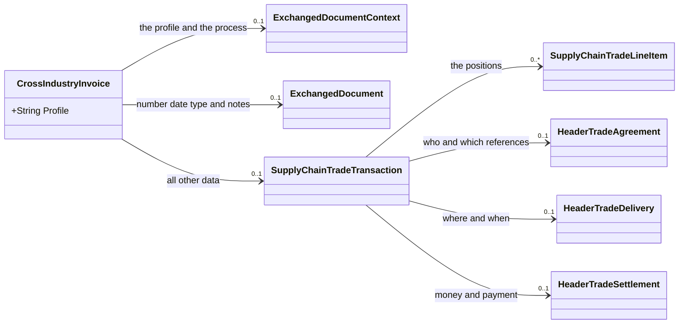

Learn these four names. They give you almost all data:

| Property | Content |
|---|---|
| `ExchangedDocument` | The number, the date, the type, and the notes. |
| `ApplicableHeaderTradeAgreement` | The seller, the buyer, and the references to other documents. |
| `ApplicableHeaderTradeDelivery` | The goods receiver and the delivery date. |
| `ApplicableHeaderTradeSettlement` | The currency, the tax, the totals, and the payment. |

## The value types

A simple value of the schema becomes a small class. The class also holds the attributes of
the element. Thus no data of the document goes away.

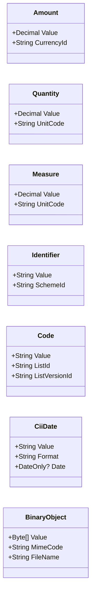

Three rules help you with these types:

- **Always ask for `Value`.** An amount of 198.00 is `amount.Value`, not `amount`.
- **A date has two forms.** `CiiDate.Value` is the raw text of the document, for example
  `20200305`. `CiiDate.Date` is a `DateOnly?`. Use `Date` to show the date, and `Value` to
  write the document back without a change.
- **A percent is a plain `decimal?`.** `udt:PercentType` and `udt:RateType` have no
  attributes, thus they need no class.

`Amount`, `Quantity`, `Measure`, `Identifier`, `Code` and `CiiDate` take their value with
an implicit conversion. Thus `document.Id = "R-2026-0815"` works without a constructor.

## The document

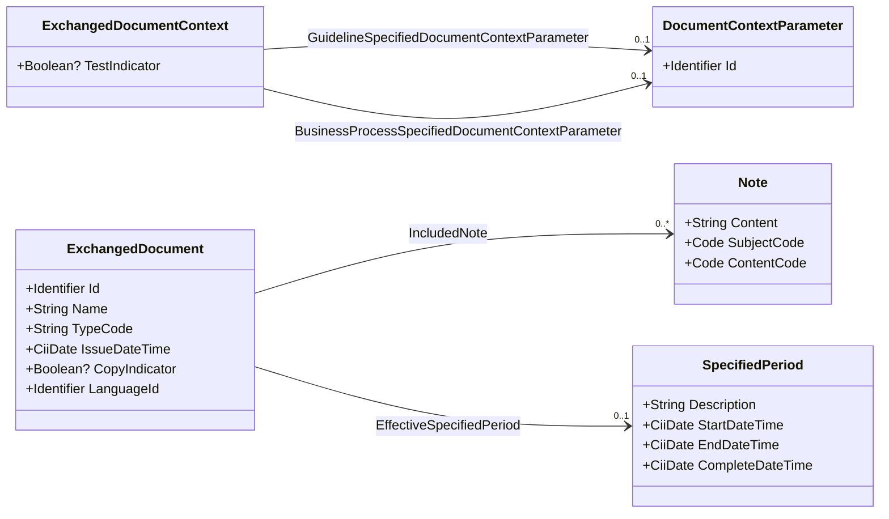

`GuidelineSpecifiedDocumentContextParameter.Id` holds the profile of the document, for
example `urn:factur-x.eu:1p0:minimum`. `CrossIndustryInvoice.Profile` gives the same value
directly.

## Parties

A party is a company or a person. All parties have the same class `TradeParty`.

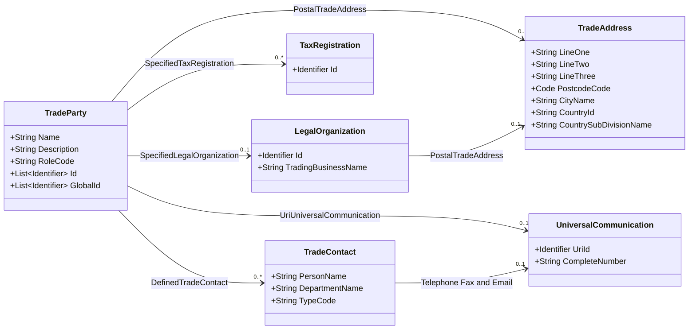

Notes on the parties:

- **`Id` and `GlobalId` are lists.** A party can have more than one number. Take the first
  entry with a value.
- **`TaxRegistration.Id.SchemeId` gives the kind.** `VA` is the VAT ID, `FC` is the tax
  number.
- **A contact has three communications.** `TelephoneUniversalCommunication` and
  `FaxUniversalCommunication` use `CompleteNumber`. `EmailUriUniversalCommunication` uses
  `UriId.Value`.
- **The address has three lines.** The renderer of Pacioli writes all three.

## The agreement, the delivery, and the settlement

The three groups hold the header data. The diagram shows where each party sits.

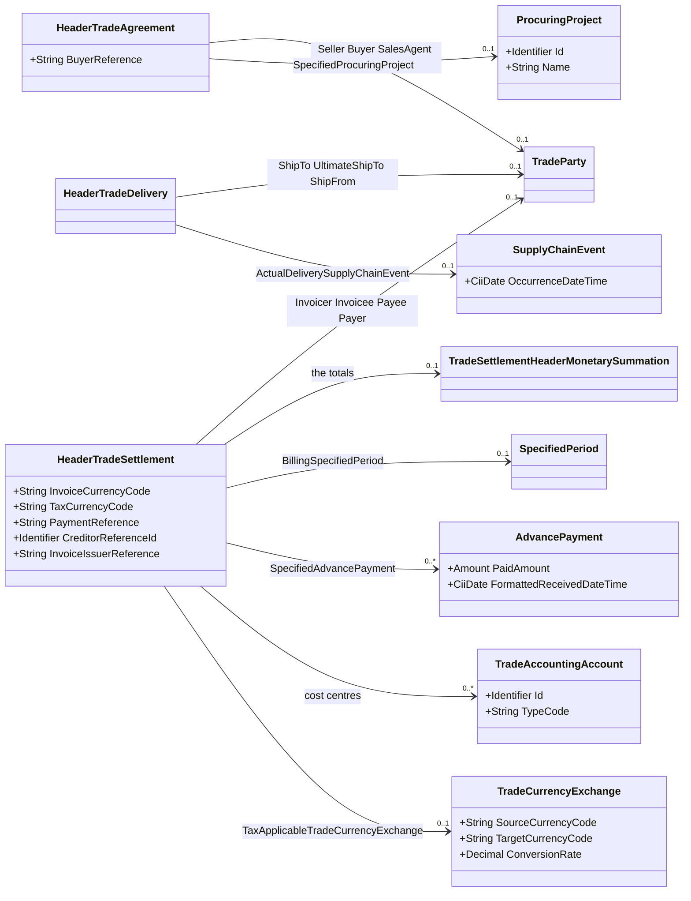

The nine totals of the invoice sit together:

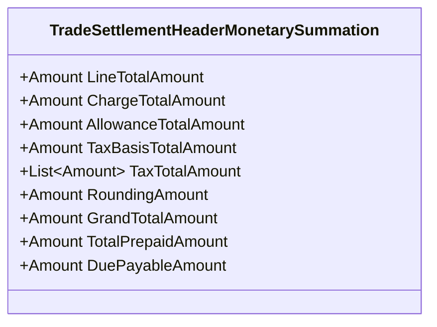

**`TaxTotalAmount` is a list.** A document with a foreign currency holds the tax amount two
times: one time in the currency of the invoice, and one time in the currency of the tax.
Take the first entry, or select the entry by `Amount.CurrencyId`.

## Positions

`SupplyChainTradeLineItem` is one position. It has the same three groups as the header,
and one group for the product.

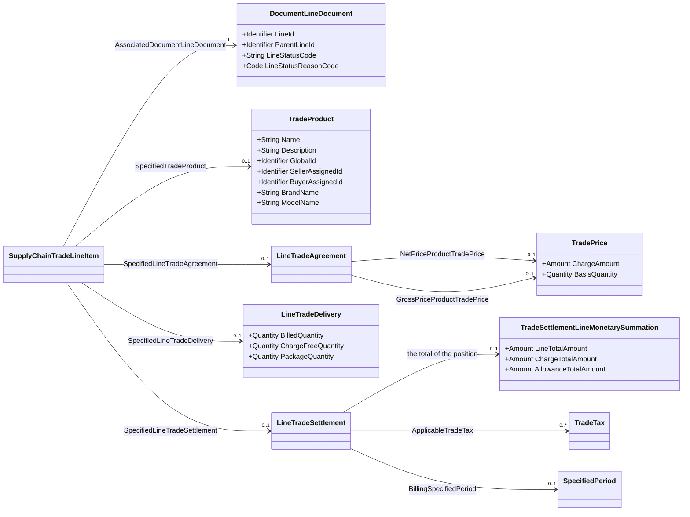

The product can hold more data:

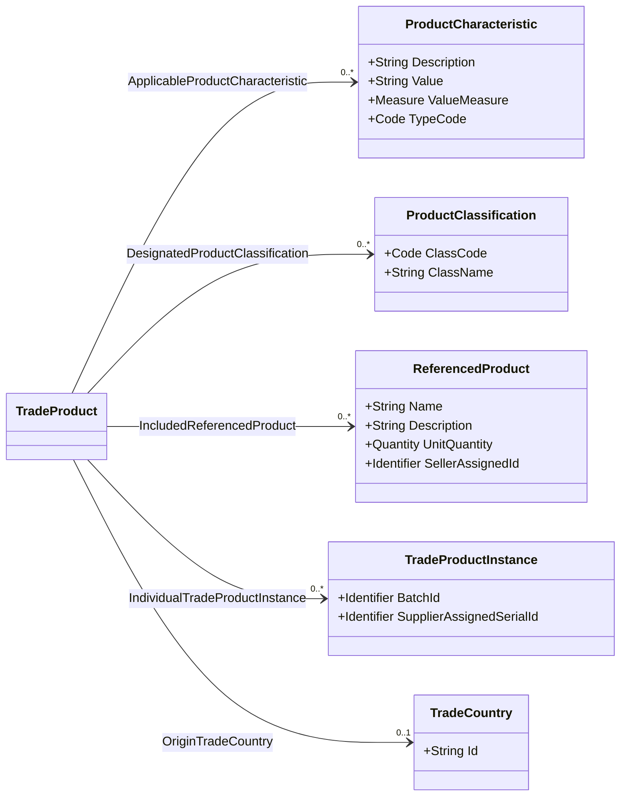

Where the data of a position sits:

| Data | Path below the position |
|---|---|
| Name | `SpecifiedTradeProduct.Name` |
| Quantity | `SpecifiedLineTradeDelivery.BilledQuantity.Value` |
| Unit | `SpecifiedLineTradeDelivery.BilledQuantity.UnitCode` |
| Net unit price | `SpecifiedLineTradeAgreement.NetPriceProductTradePrice.ChargeAmount.Value` |
| Gross unit price | `SpecifiedLineTradeAgreement.GrossPriceProductTradePrice.ChargeAmount.Value` |
| Tax rate | `SpecifiedLineTradeSettlement.ApplicableTradeTax[0].RateApplicablePercent` |
| Total | `SpecifiedLineTradeSettlement.SpecifiedTradeSettlementLineMonetarySummation.LineTotalAmount.Value` |

**A sub position uses `ParentLineId`.** The positions stay flat in the XML document. The
parent is a reference only. `LineStatusCode` tells the kind of the position.

## Tax, allowances, and charges

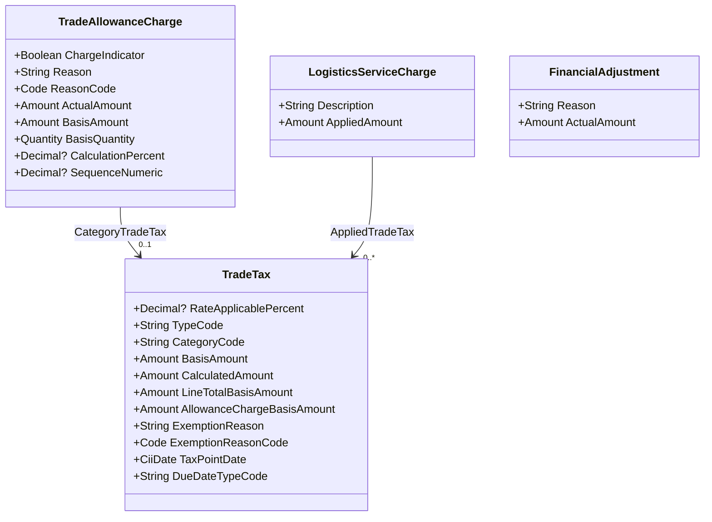

`ChargeIndicator` tells the direction. `true` is a charge, `false` is an allowance. One
class holds both, thus you must always read this field.

An allowance or a charge can sit at three places:

| Place | Meaning |
|---|---|
| `ApplicableHeaderTradeSettlement.SpecifiedTradeAllowanceCharge` | It applies to the document. |
| `SpecifiedLineTradeSettlement.SpecifiedTradeAllowanceCharge` | It applies to the position. |
| `GrossPriceProductTradePrice.AppliedTradeAllowanceCharge` | It makes the net price out of the gross price. |

## Payment

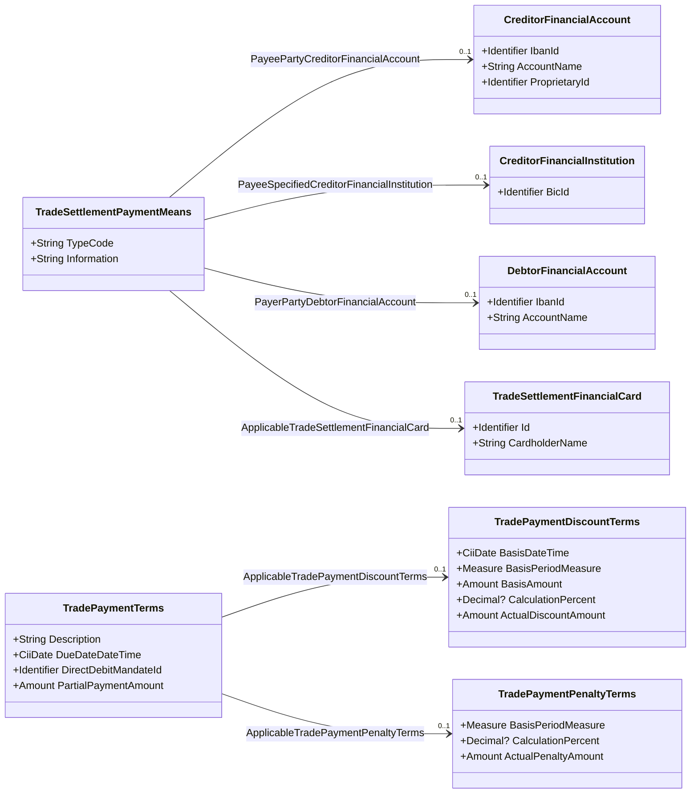

The bank data of the seller sits in `PayeePartyCreditorFinancialAccount`. The IBAN is
`IbanId.Value`. The BIC is not in the account: it sits in
`PayeeSpecifiedCreditorFinancialInstitution.BicId.Value`.

The discount terms (Skonto) sit in `ApplicableTradePaymentDiscountTerms`. The number of
days is `BasisPeriodMeasure.Value`, and the unit code is `DAY`.

## Referenced documents

One class holds all references. The name of the property tells the kind of the document.

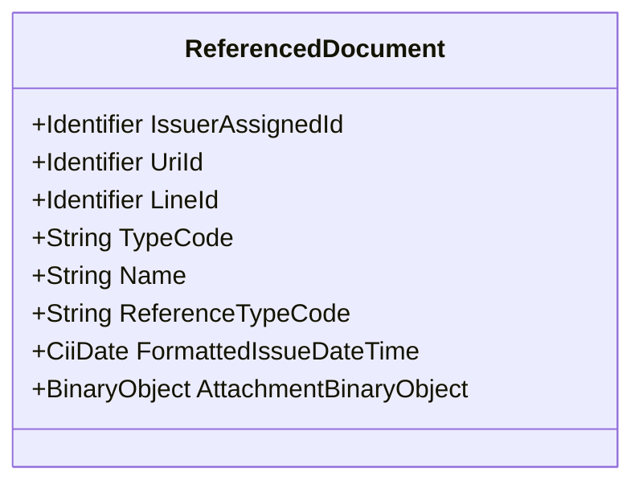

| Property of the group | Kind of the document |
|---|---|
| `SellerOrderReferencedDocument` | The order number of the seller. |
| `BuyerOrderReferencedDocument` | The order number of the buyer. |
| `ContractReferencedDocument` | The contract. |
| `QuotationReferencedDocument` | The quotation. |
| `DeliveryNoteReferencedDocument` | The delivery note. |
| `DespatchAdviceReferencedDocument` | The despatch advice. |
| `InvoiceReferencedDocument` | The invoice that this document corrects. |
| `AdditionalReferencedDocument` | An attachment, or another document. |

An attachment holds its data in `AttachmentBinaryObject`: `Value` are the bytes, `FileName`
is the name of the file, and `MimeCode` is the media type.

## The code constants

The model keeps a code as a `string`, and not as an enumeration. Thus a code of a new
version reads without a change of the library. These classes hold the usual values:

| Class | Examples |
|---|---|
| `Profiles` | `Minimum`, `BasicWithoutLines`, `Basic`, `En16931`, `Extended`, `XRechnung` |
| `DocumentTypeCodes` | `CommercialInvoice` = `380`, `CreditNote` = `381`, `CorrectedInvoice` = `384` |
| `TaxCategoryCodes` | `StandardRate` = `S`, `ZeroRated` = `Z`, `Exempt` = `E`, `ReverseCharge` = `AE` |
| `TaxTypeCodes` | `ValueAddedTax` = `VAT` |
| `PaymentMeansCodes` | `Cash` = `10`, `Cheque` = `20`, `CreditTransfer` = `30`, `BankCard` = `48` |
| `NoteSubjectCodes` | `GeneralInformation` = `AAI`, `TermsOfDelivery` = `AAB` |
| `ReferenceTypeCodes` | `BuyerOrderNumber` = `ON`, `ContractNumber` = `CT`, `Gtin` = `0160` |
| `LineStatusCodes` | `Detail` = `1`, `Information` = `2`, `GroupTotal` = `3`, `Group` = `4` |
| `DateFormatCodes` | `CcyyMmDd` = `102` |

Compare a code with a constant, and do not write the text yourself:

```csharp
if (invoice.ExchangedDocument.TypeCode == DocumentTypeCodes.CreditNote) { ... }
```

### Caution with the profile of XRechnung

Do not compare the profile with `Profiles.XRechnung`. The constant holds
`urn:cen.eu:en16931:2017#compliant#urn:xoev-de:kosit:standard:xrechnung_3.0`, but the
XRechnung samples of ZUGFeRD 2.5.2 hold a different text:

| Text of the sample | Samples |
|---|---:|
| `...#compliant#urn:xeinkauf.de:kosit:xrechnung_3.0` | 3 |
| `...#compliant#urn:xoev-de:kosit:standard:xrechnung_2.1` | 1 |

Thus the constant agrees with no XRechnung sample. The five other constants of `Profiles`
agree with the samples. To find an XRechnung document, look for the text `xrechnung` in the
profile:

```csharp
bool isXRechnung = invoice.Profile?.Contains("xrechnung") == true;
```

## How Pacioli uses the model

`InvoiceWriter` in the project `Pacioli.Pdf` writes the data to the PDF page. The class has
short properties for the groups, thus the code stays readable:

```csharp
SupplyChainTradeTransaction? Transaction => invoice.SupplyChainTradeTransaction;
HeaderTradeAgreement?       Agreement   => Transaction?.ApplicableHeaderTradeAgreement;
HeaderTradeDelivery?        Delivery    => Transaction?.ApplicableHeaderTradeDelivery;
HeaderTradeSettlement?      Settlement  => Transaction?.ApplicableHeaderTradeSettlement;
```

Almost all properties of the model can be null. Use the null conditional operator `?.` for
each step of a path.

The renderer does not write all fields. The test project `Pacioli.CLI.Test` measures
this: it renders each sample document, then it looks for each value of the XML input on the
page. The test makes a report:

```
src\TestResults\xml-value-report.md
```

With the FeRD samples of version 2.5.2, the page shows 73 % of the values. 21 % are codes
and technical data that the page must not show in this form. The renderer does not show the
last 6 %. For the full list with the reasons, see the report, and see `XmlValueExclusions.All`
in the test project.

## History

Before, Pacioli used the class `InvoiceDescriptor` of the library `ZUGFeRD-csharp`. That
library gave a flat model. The document [InvoiceDescriptor.md](InvoiceDescriptor.md) shows
its structure. Pacioli does not use that library any more.
