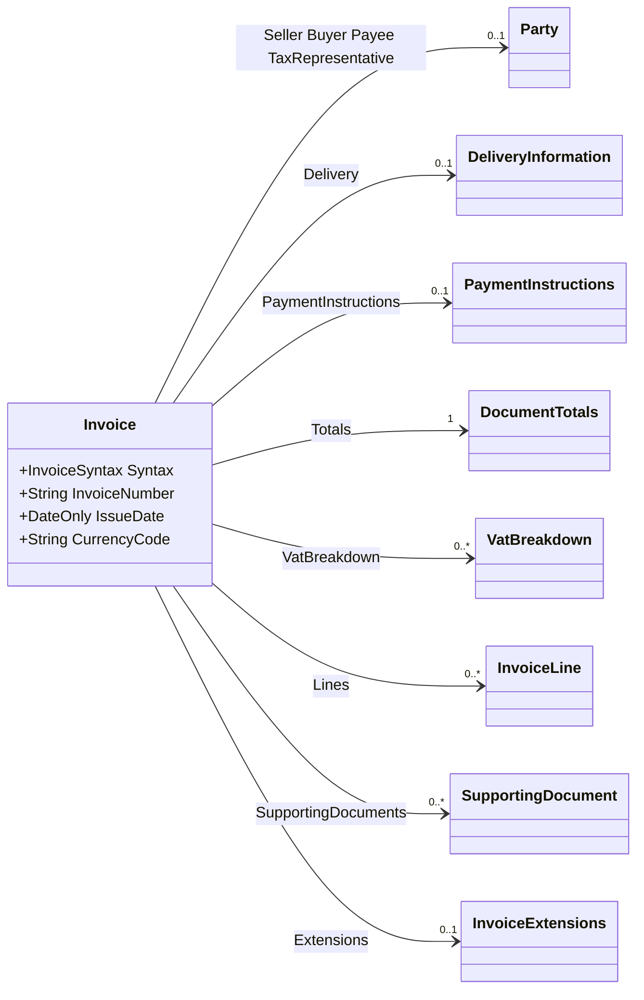
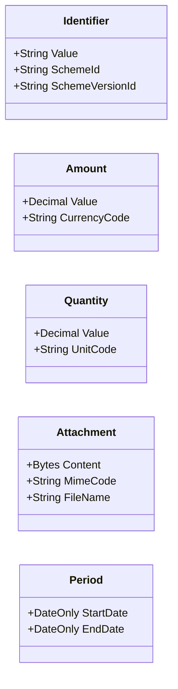
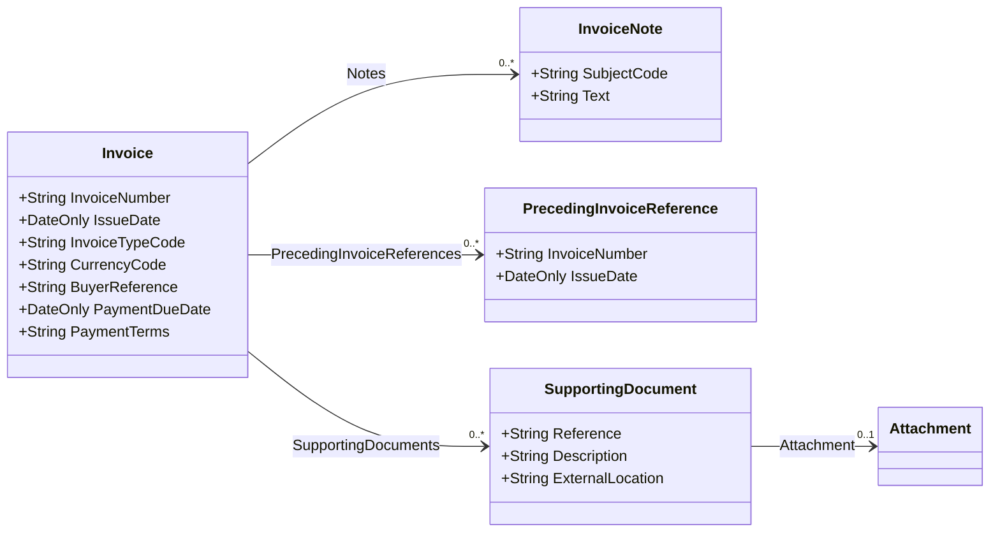
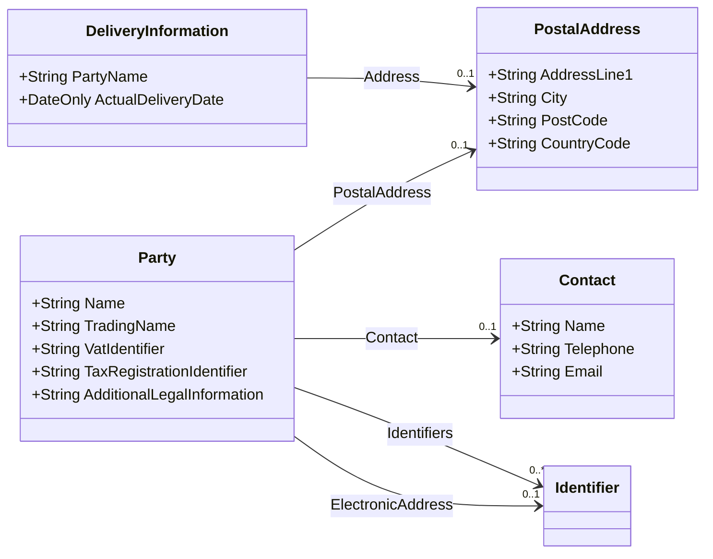
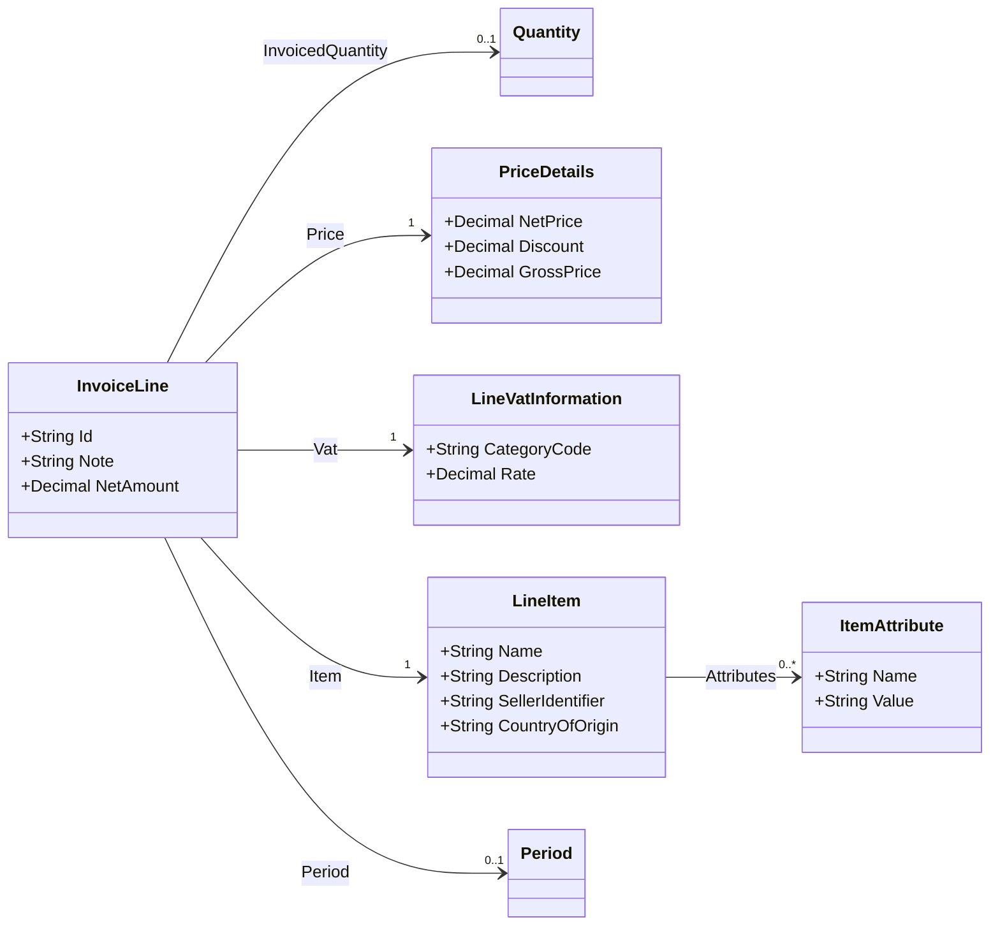
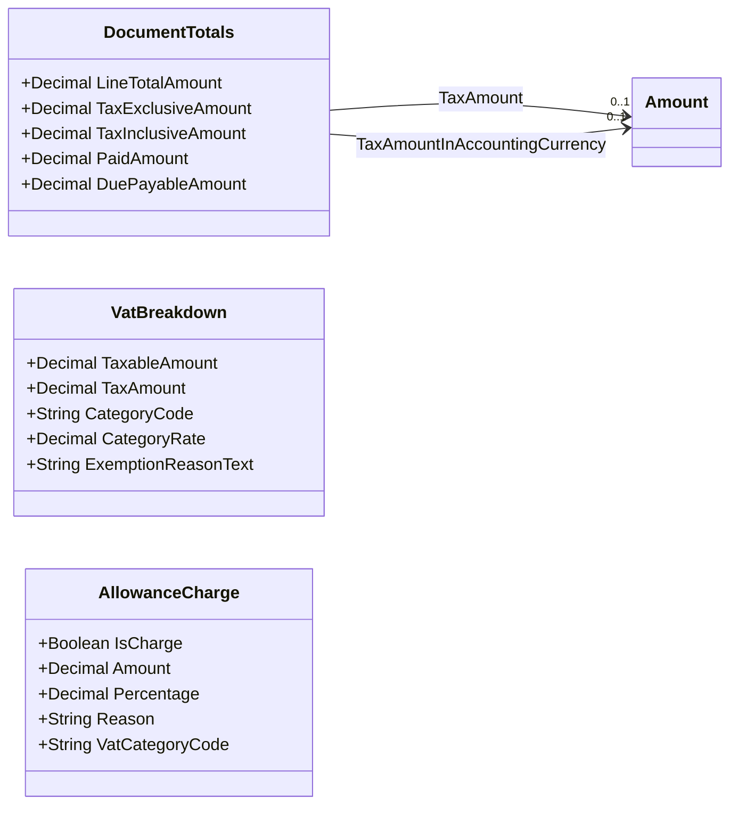
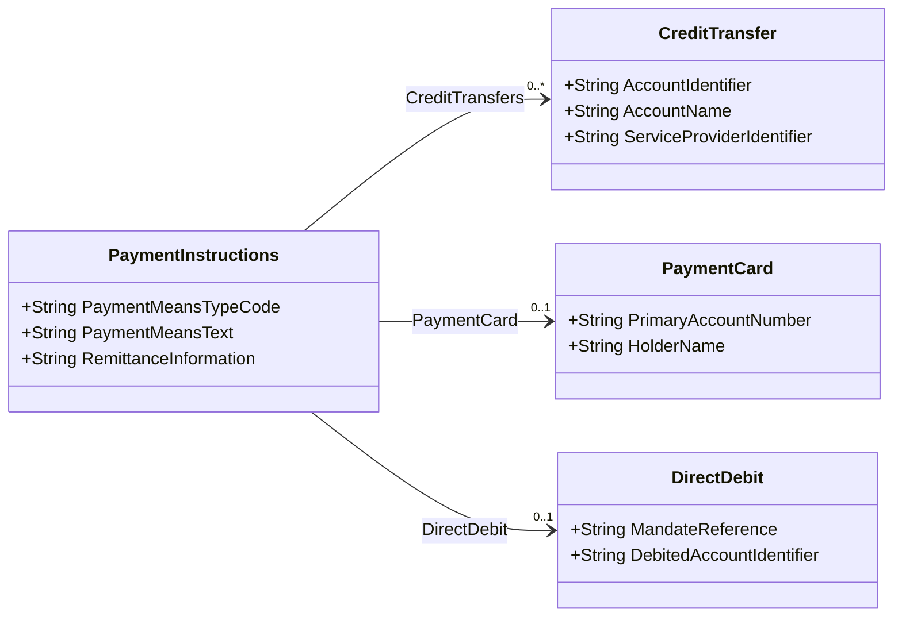

# The project En16931

`En16931` reads an electronic invoice into a data model. Pacioli uses this model for all
invoice data.

- Project: `src\En16931`
- Namespaces: `En16931`, `En16931.Model`, `En16931.Model.Extended`, `En16931.Codes`
- Target framework: `net10.0`
- No package: the project belongs to this solution.

The model follows **EN 16931-1**, the European standard for the core of an electronic
invoice. The standard gives each value a number: a business term `BT-1` is the invoice
number, a business group `BG-4` is the seller. **Each property of the model carries its
number in its doc comment.** Thus you can read the standard and the code together.

The project reads both XML syntaxes that CEN/TS 16931-2 permits:

| Syntax | Where you meet it |
|---|---|
| UN/CEFACT CII | ZUGFeRD, Factur-X, and the CII form of XRechnung |
| OASIS UBL 2.1 | The UBL form of XRechnung, and PEPPOL |

**One model serves both.** A reader of the model cannot see which syntax the document had,
except from the property `Invoice.Syntax`.

## Contents

- [How to read a document](#how-to-read-a-document)
- [Overview](#overview)
- [The value types](#the-value-types)
- [The document](#the-document)
- [Parties](#parties)
- [Positions](#positions)
- [Tax, allowances, and charges](#tax-allowances-and-charges)
- [Payment](#payment)
- [Data over the core: the extensions](#data-over-the-core-the-extensions)
- [The code lists](#the-code-lists)
- [What UBL does not hold](#what-ubl-does-not-hold)
- [How Pacioli uses the model](#how-pacioli-uses-the-model)
- [History](#history)

## How to read a document

`InvoiceReader` is the way into the library.

| Method | Function |
|---|---|
| `InvoiceReader.ReadFile(string path)` | Reads an invoice from a file. |
| `InvoiceReader.Read(Stream stream)` | Reads an invoice from a stream. |
| `InvoiceReader.ReadXml(string xml)` | Reads an invoice out of a string. |
| `InvoiceReader.Read(XDocument document)` | Reads an invoice that is already loaded. |
| `InvoiceReader.TryRead(Stream, out Invoice?)` | Reads, and gives `false` in the place of an exception. |
| `InvoiceReader.DetectSyntax(XDocument)` | Gives the syntax, without a parse of the document. |

```csharp
var invoice = InvoiceReader.ReadFile(@"C:\in\factur-x.xml");

Console.WriteLine(invoice.InvoiceNumber);                  // BT-1
Console.WriteLine(invoice.Seller?.Name);                   // BT-27
Console.WriteLine(invoice.Totals.DuePayableAmount);        // BT-115
```

`DetectSyntax` looks at the root element only. It is fast, and it raises no exception, thus
it is the correct test for a document of an unknown kind:

```csharp
if (InvoiceReader.DetectSyntax(document) != InvoiceSyntax.Unknown)
{
    var invoice = InvoiceReader.Read(document);
}
```

**The reader is permissive.** A missing or a wrong value gives `null` on the model, and not
an exception. Thus an invoice that breaks a business rule still reads, and a program can
show it. `InvoiceFormatException` comes for two reasons only: the text is not well formed
XML, or the root element belongs to neither syntax.

The reader does not check the business rules of EN 16931. For that, use the Schematron of
the specification.

## Overview

The model is **flat**. A value stands where the standard puts it, and not where the XML
schema puts it:

```csharp
invoice.Seller.PostalAddress.City               // En16931
invoice.SupplyChainTradeTransaction             // the old model of the CII schema
       .ApplicableHeaderTradeAgreement
       .SellerTradeParty.PostalTradeAddress.CityName
```



Learn these names. They give you almost all data:

| Property | Business group | Content |
|---|---|---|
| `Seller`, `Buyer` | BG-4, BG-7 | Who sends the invoice, and who gets it. |
| `Lines` | BG-25 | The positions. |
| `Totals` | BG-22 | The sums of the document. |
| `VatBreakdown` | BG-23 | One entry for each tax rate. |
| `PaymentInstructions` | BG-16 | How the buyer pays. |
| `Extensions` | — | Data that goes over the core. See below. |

Almost every property can be `null`, because a profile with few fields, for example
MINIMUM, fills few groups. Use the null conditional operator `?.` for each step.

`Totals` is the one property that is never `null`: an invoice always has totals, and an
empty `DocumentTotals` shows that the document gives none.

## The value types

A value that carries more than a text becomes a small record. Thus no data of the document
goes away.



| Type | Use |
|---|---|
| `Identifier` | An identifier with the scheme that it stands under, for example a GLN under the scheme `0088`. |
| `Amount` | An amount with its currency. The model uses it only where the currency can differ from BT-5, for example for BT-111. |
| `Quantity` | A quantity with its unit of measure (UN/ECE Recommendation 20). |
| `Attachment` | The content of an attached file, with its media type and its file name. |
| `Period` | A date range: BG-14 for the document, BG-26 for a position. |

An amount that always stands in the currency of the invoice is a plain `decimal`. Thus a
sum needs no unpacking.

A date is a `DateOnly`. The reader knows the form of both syntaxes: CII gives `20260315`
with the format code 102, UBL gives `2026-03-15`.

## The document



| Property | Term | Content |
|---|---|---|
| `InvoiceNumber` | BT-1 | The number of the invoice. |
| `IssueDate` | BT-2 | The day of the invoice. |
| `InvoiceTypeCode` | BT-3 | `380` for an invoice, `381` for a credit note. |
| `CurrencyCode` | BT-5 | The currency of the invoice. |
| `TaxCurrencyCode` | BT-6 | The currency of the tax, if it differs. |
| `PaymentDueDate` | BT-9 | The day of the payment. |
| `BuyerReference` | BT-10 | The reference of the buyer. In Germany, the Leitweg-ID. |
| `ProjectReference` | BT-11 | The project. |
| `ContractReference` | BT-12 | The contract. |
| `PurchaseOrderReference` | BT-13 | The order of the buyer. |
| `SalesOrderReference` | BT-14 | The order of the seller. |
| `PaymentTerms` | BT-20 | The text of the payment terms. |
| `SpecificationIdentifier` | BT-24 | The rule set that the invoice follows. |
| `Notes` | BG-1 | The notes, each one with its subject code (BT-21). |

## Parties

One type serves the four roles. EN 16931 gives the same kind of data a different number per
role; the doc comment of each property names all of them.



| Property of `Invoice` | Group | Role |
|---|---|---|
| `Seller` | BG-4 | The party that sends the invoice. |
| `Buyer` | BG-7 | The party that gets the invoice. |
| `Payee` | BG-10 | The party that gets the money, if it is not the seller. |
| `SellerTaxRepresentative` | BG-11 | The tax representative of the seller. |
| `Delivery` | BG-13 | Where the goods go, and when. |

`Party.Contact` holds one contact, because EN 16931 gives one contact per party. A document
can name more; see [the extensions](#data-over-the-core-the-extensions).

## Positions



| Property | Term | Content |
|---|---|---|
| `Id` | BT-126 | The number of the position. |
| `InvoicedQuantity` | BT-129, BT-130 | How much, and in which unit. |
| `NetAmount` | BT-131 | The sum of the position. |
| `Price.NetPrice` | BT-146 | The price of one unit. |
| `Price.BaseQuantity` | BT-149, BT-150 | For how many units the price applies. |
| `Vat.CategoryCode` | BT-151 | The tax category of the position. |
| `Vat.Rate` | BT-152 | The tax rate of the position. |
| `Item.Name` | BT-153 | The name of the article. |
| `Item.StandardIdentifier` | BT-157 | For example a GTIN, with its scheme. |

`Price` and `Vat` and `Item` are never `null`. A position always has these three groups,
and an empty group shows that the document gives no value.

## Tax, allowances, and charges



| Property of `Invoice` | Group | Content |
|---|---|---|
| `Totals` | BG-22 | The sums: BT-106 to BT-115. |
| `VatBreakdown` | BG-23 | One entry per tax category and rate. |
| `Allowances` | BG-20 | The allowances of the document. |
| `Charges` | BG-21 | The charges of the document. |

**An allowance and a charge have the same form.** The two syntaxes separate them by an
indicator, thus one type serves both, and `IsCharge` tells them apart. The same type also
serves a position (BG-27 and BG-28); there the properties for the tax stay empty.

`Totals.TaxAmount` is BT-110, in the currency of the invoice.
`Totals.TaxAmountInAccountingCurrency` is BT-111, in the currency of the tax. The two share
one element in both syntaxes, and the reader tells them apart by the currency.

## Payment



`CreditTransfer.AccountIdentifier` is BT-84. It holds the IBAN, or the account number of a
bank that gives no IBAN.

The creditor identifier of a SEPA mandate (BT-90) stands on `Seller`, and not here: it
belongs to the seller, although CII writes it with the settlement.

## Data over the core: the extensions

The core model holds the business terms of EN 16931, and nothing else. A document of the
ZUGFeRD **EXTENDED** profile holds more: an advance payment, a discount term, the serial
number of an article. A reader of the invoice needs this data, and it has no BT number.

Therefore a type of the core carries an `Extensions` property. The property is `null` if
the document gives no such data:

```csharp
invoice.Seller.Name                        // BT-27, the core
invoice.Seller.Extensions?.Contacts        // each contact, over the core
line.Item.Extensions?.Instances            // the serial numbers
invoice.Extensions?.AdvancePayments        // the payments before this invoice
```

**The rule:** a term with a BT or a BG number belongs to the core. A term without one
belongs to an extension. Thus the core keeps its form, and it stays a model of the
standard.

Eleven types of the core carry the property:

| Type of the core | Property | Extension type |
|---|---|---|
| `Invoice` | `Extensions` | `InvoiceExtensions` |
| `InvoiceNote` | `Extensions` | `NoteExtensions` |
| `Party` | `Extensions` | `PartyExtensions` |
| `Contact` | `Extensions` | `ContactExtensions` |
| `PrecedingInvoiceReference` | `Extensions` | `PrecedingInvoiceExtensions` |
| `SupportingDocument` | `Extensions` | `SupportingDocumentExtensions` |
| `PaymentInstructions` | `Extensions` | `PaymentExtensions` |
| `InvoiceLine` | `Extensions` | `InvoiceLineExtensions` |
| `LineItem` | `Extensions` | `LineItemExtensions` |
| `PriceDetails` | `Extensions` | `PriceExtensions` |
| `VatBreakdown` | **`Detail`** | `TaxDetail` |

`VatBreakdown` uses the name `Detail`, because the property holds the full tax of that one
entry and not a group of extra fields.

### What the extensions hold

| Group | Where | Content |
|---|---|---|
| Title of the document | `InvoiceExtensions.Title` | For example "RECHNUNG". |
| Invoicee, ship-from, ship-to | `InvoiceExtensions` | Parties that the core does not hold, or holds in part. |
| Payment terms | `InvoiceExtensions.PaymentTerms` | Each term, with its discount (Skonto) and its penalty (Verzugszinsen). |
| Advance payments | `InvoiceExtensions.AdvancePayments` | The amount, the day, the tax, and the invoice of the payment. |
| Logistics service charges | `InvoiceExtensions.LogisticsServiceCharges` | The costs of the transport. |
| Exchange rate | `InvoiceExtensions.TaxCurrencyExchange` | Between the currency of the invoice and the currency of the tax. |
| Referenced documents | `InvoiceExtensions` and `InvoiceLineExtensions` | The quotation, the delivery note, the despatch advice, and the documents of the head and of a position. |
| Mode of transport | `InvoiceExtensions.TransportModeCodes` | UN/ECE Recommendation 19. |
| More than one contact | `PartyExtensions.Contacts` | With the department and the fax number. |
| Tax registrations | `PartyExtensions.TaxRegistrations` | Each registration with its scheme, for example `VA` and `FC`. |
| Serial numbers | `LineItemExtensions.Instances` | The serial number and the batch of an article. |
| Products in a set | `LineItemExtensions.IncludedProducts` | The parts of a bundle. |
| Full tax | `TaxDetail` | The type code, the basis amounts, and the day of the tax. |

### One group in two places

Two groups stand in the core **and** in an extension, because the two views have a
different use:

- **`InvoiceExtensions.AdditionalDocuments`** holds the documents of the head as the
  document gives them. CII puts three business terms in one group and separates them by a
  type code: 130 is the invoiced object (BT-18), 50 is the tender or lot (BT-17), each
  other code is a supporting document (BG-24). The core follows that split. A reader that
  wants to show the group as one list takes this property.
- **`InvoiceExtensions.InvoicedObjectIdentifiers`** holds each object identifier. BT-18
  gives one, and the core keeps the first; a document of the EXTENDED profile can name
  more than one object.

## The code lists

`En16931.Codes.CodeLists` gives the name of a code, in English and in German. The model
keeps a code as it stands in the document, because the code is the value of the business
term; the list gives the text for a page or for a log.

```csharp
CodeLists.DocumentType.GetName("380");                        // "Commercial invoice"
CodeLists.DocumentType.GetName("380", CodeLanguage.German);   // "Handelsrechnung"
CodeLists.UnitOfMeasure.GetName("H87", CodeLanguage.German);  // "Stück"
CodeLists.DocumentType.Describe("380");                       // "380 (Commercial invoice)"
CodeLists.DocumentType.Describe("ZZZ");                       // "ZZZ" — the code alone
```

`GetName` gives `null` for a code that the list does not hold. `Describe` always gives a
usable text, thus it fits a page.

The class holds **24 lists**: the document types (UNTDID 1001), the tax categories (5305),
the units of measure (Rec 20 and 21, 2162 codes), the countries, the currencies, and the
others. `CodeLists.All` gives each one, and `CodeLists.ById` finds one by its identifier.

An allowance and a charge take their reason from two different lists.
`CodeLists.ReasonFor(allowanceCharge)` gives the correct one.

The specification gives its lists in English and in French only, thus the German table is
kept by hand. A code without a German name falls back to the English name, thus
`GetName(code, CodeLanguage.German)` never gives `null` for a known code.
`CodeLists.GermanCoverage` tells how far the German table goes.

### A code that the workbook does not hold

`CodeListData.g.cs` comes from a program. Do not put an entry there by hand: the next run
of the program removes it. The file `CodeListDataExtra.cs` is the place for a code that
documents of the practice use and that the workbook does not give. Today it holds one
entry: `9958`, the scheme of the German Leitweg-ID.

**An extra entry fills a hole only.** The name of the specification has priority, thus an
extra entry can never change an official name.

## What UBL does not hold

The two syntaxes do not hold the same groups. A group that UBL does not know stays `null`
for a UBL document, and a program must not depend on it:

| Group | CII | UBL |
|---|---|---|
| Title of the document | yes | no |
| Content code of a note | yes | no |
| Invoicee party, ship-from party | yes | no |
| Logistics service charge | yes | no |
| Advance payment | yes | no |
| Address of the legal organisation | yes | no |
| Serial number, products in a set | yes | no |
| Subject code of a note (BT-21) | an element | the code stands before the text between two number signs, for example `#AAI#Ein Hinweis` |

UBL holds one contact per party, and CII can hold more.

## How Pacioli uses the model

`InvoiceWriter` in the project `Pacioli.Pdf` writes the data to the PDF page. It reads the
invoice one time, and it gives the model to each section of the page:

```csharp
var extractor = new EInvoiceExtractor(fileName);      // the XML out of a PDF/A-3 file
var invoice = InvoiceReader.Read(xmlData);            // the model
```

A section reads `context.Core`. There is no short way into a tree any more, because the
model is flat.

The renderer does not write each value to the page. The test project `Pacioli.CLI.Test`
measures this: it renders each sample document, then it looks for each value of the XML
input on the page. The test writes a report:

```
src\TestResults\xml-value-report.md
```

With the samples of the specification and the corpus of ZUGFeRD, the page shows about 86 %
of the values. The other values are codes and technical data that the page must not show in
this form; the page shows their meaning. For the full list with the reasons, see the
report, and see `XmlValueExclusions.All` in the test project.

## History

Pacioli used two other libraries before:

| Library | Model | Document |
|---|---|---|
| `ZUGFeRD-csharp` of s2industries | `InvoiceDescriptor`, a flat model | [InvoiceDescriptor.md](InvoiceDescriptor.md) |
| `Vit.FeRD.ExtendedDocument` | `CrossIndustryInvoice`, the tree of the CII schema | [CrossIndustryInvoice.md](CrossIndustryInvoice.md) |

Both read CII only. Pacioli could therefore not read a UBL invoice, and about one half of
the German XRechnung documents use UBL.

The migration to `En16931` closed that gap. [En16931-Migration.md](En16931-Migration.md)
tells how it went, phase by phase, and which defects it found on the way.
