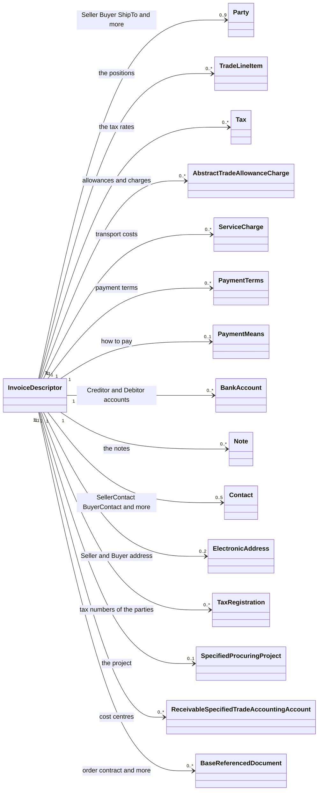
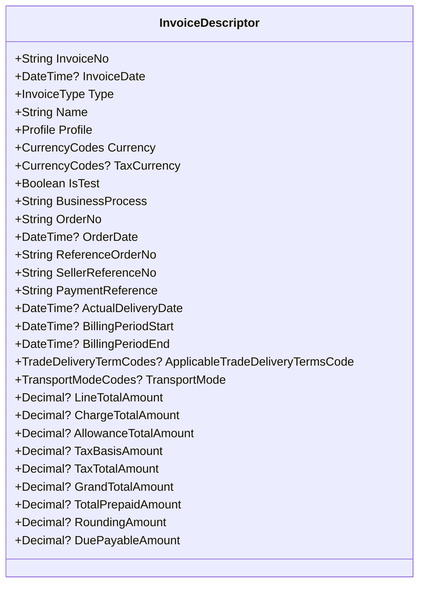
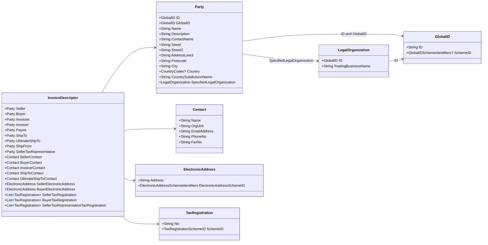
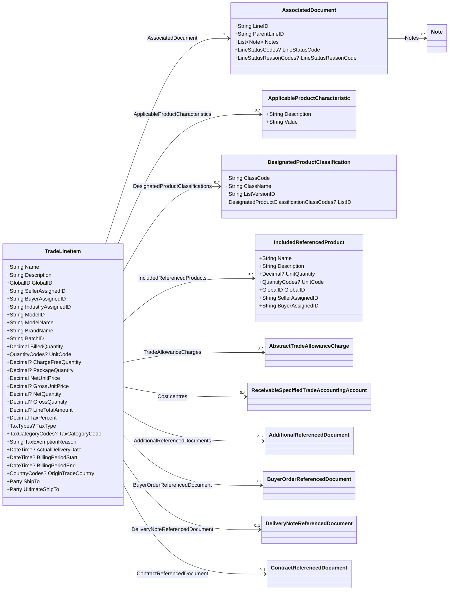
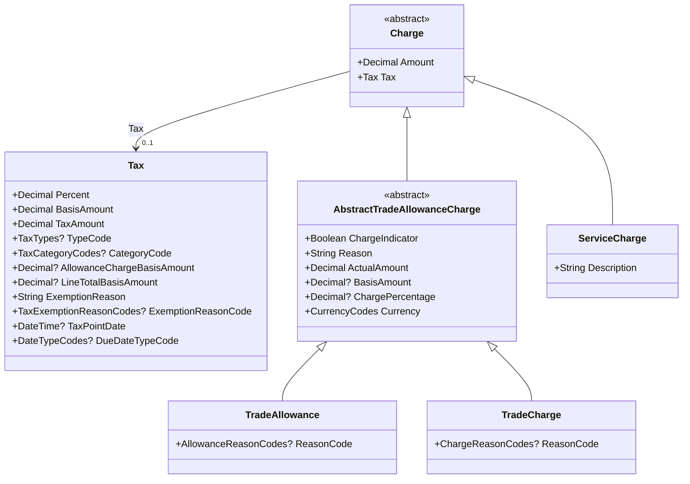
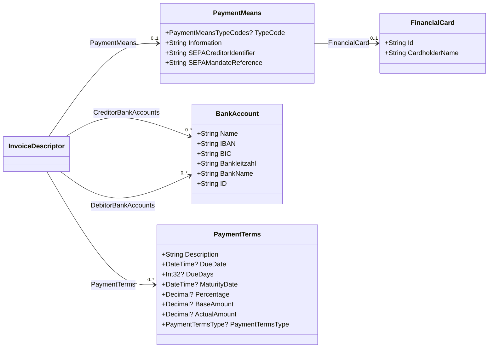
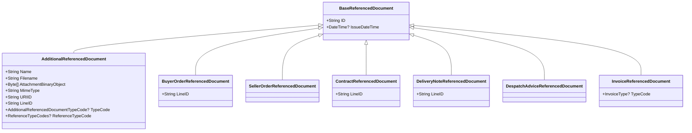

# The class InvoiceDescriptor

> **Pacioli does not use this library any more.** The parser is now
> `Vit.FeRD.ExtendedDocument`. For the model that Pacioli uses today, see
> [CrossIndustryInvoice.md](CrossIndustryInvoice.md). This document stays for the history,
> and for a comparison of the two models.

`InvoiceDescriptor` is the data model of an electronic invoice. Pacioli used it for all
invoice data. The class comes from the library `ZUGFeRD-csharp` of s2industries.

- Namespace: `s2industries.ZUGFeRD`
- Assembly: `s2industries.ZUGFeRD.dll`, version **18.0.0**
- Package: `ZUGFeRD-csharp` 18.0.0

`InvoiceDescriptor.Load()` makes the object. It reads an XML file, or a stream with the
XML data from a ZUGFeRD PDF file. `Pacioli.Pdf` then writes the data to a PDF page. For
more data about this step, see [the note at the end](#which-data-pacioli-shows).

> This document shows the structure of version 18.0.0. If you change the version of the
> package, examine the diagrams again.

## Contents

- [Overview](#overview)
- [Data of the document](#data-of-the-document)
- [Parties](#parties)
- [Positions](#positions)
- [Tax, allowances, and charges](#tax-allowances-and-charges)
- [Payment](#payment)
- [Referenced documents](#referenced-documents)
- [How to read a list](#how-to-read-a-list)
- [Which data Pacioli shows](#which-data-pacioli-shows)

## Overview

The diagram shows the parts of an invoice. It does not show the simple fields. The
sections after it show the fields.



## Data of the document

These fields hold the data of the invoice itself, and the totals.



The nine amounts make the summary of the invoice. `SetTotals()` writes all of them
together.

`Profile` tells which ZUGFeRD profile the document uses: `Minimum`, `BasicWL`, `Basic`,
`Comfort`, `Extended`, `XRechnung`, and more. A profile with few fields, for example
`Minimum`, leaves most fields empty.

## Parties

A party is a company or a person. One invoice has more than one party. Each party has the
same structure.



`TaxRegistration` holds the tax number and the VAT ID. The `SchemeID` tells the kind:
`FC` is the tax number, `VA` is the VAT ID.

## Positions

`TradeLineItem` is one position of the invoice. `GetTradeLineItems()` gives the list.



`AssociatedDocument.LineID` is the position number from the XML file.
`ParentLineID` makes a sub position: it names the position above.

A position holds two lists of allowances and charges: `TradeAllowanceCharges` and
`SpecifiedTradeAllowanceCharges`. The first list applies to the position. The second list
applies to the gross price.

## Tax, allowances, and charges



`ChargeIndicator` tells the direction. `true` is a charge, `false` is an allowance. The
two subclasses give the reason code for each direction.

Use `GetTradeAllowances()` and `GetTradeCharges()` to get one kind only.

## Payment



`CreditorBankAccounts` holds the accounts of the seller. `DebitorBankAccounts` holds the
accounts of the buyer, for a direct debit.

`PaymentTerms` with a `Percentage` and a `DueDays` value gives the discount terms
(Skonto).

## Referenced documents

All referenced documents have the same base class.



`AdditionalReferencedDocument` holds an attachment. `AttachmentBinaryObject` holds the
data of the file. Pacioli writes this data to a temporary file, and it opens the file when
the user clicks the link.

## How to read a list

Some lists have a `Get...` method. Use the method, not the property. A property with an
underscore at its start, for example `_InvoiceReferencedDocuments`, is not for your code.

| Method | Gives |
|---|---|
| `GetTradeLineItems()` | The positions. |
| `GetApplicableTradeTaxes()` | The tax rates of the document. |
| `GetTradeAllowanceCharges()` | The allowances and the charges together. |
| `GetTradeAllowances()` | The allowances only. |
| `GetTradeCharges()` | The charges only. |
| `GetTradePaymentTerms()` | The payment terms. |
| `GetCreditorFinancialAccounts()` | The bank accounts of the seller. |
| `GetDebitorFinancialAccounts()` | The bank accounts of the buyer. |
| `GetAdditionalReferencedDocuments()` | The attachments and the other documents. |
| `GetNotes()` | The notes of the document. |
| `GetLogisticsServiceCharges()` | The transport costs. |
| `GetSellerTaxRegistration()` | The tax numbers of the seller. |
| `GetBuyerTaxRegistration()` | The tax numbers of the buyer. |
| `GetInvoiceReferencedDocuments()` | The invoices that this document corrects. |
| `GetReceivableSpecifiedTradeAccountingAccounts()` | The cost centres. |

## Which data Pacioli shows

`InvoiceWriter` in the project `Pacioli.Pdf` writes the data to the PDF page. It does not
write all fields.

The test project `Pacioli.CLI.NET8.Test` measures this. It renders each sample document,
then it looks for each value of the XML input on the page. The test makes a report:

```
src\TestResults\xml-value-report.md
```

With the FeRD samples of version 2.5.2, the page shows 73 % of the values. 21 % are codes
and technical data that the page must not show in this form. The renderer does not show
the last 6 %.

The largest groups that the renderer does not show are:

| Element | Class in this document |
|---|---|
| The tax number and the VAT ID of a party | `TaxRegistration` |
| The position number from the XML | `AssociatedDocument.LineID` |
| The global ID of the seller | `Party.GlobalID` |
| A payment before this invoice | not in the model of the renderer |
| The order number of the seller | `SellerOrderReferencedDocument` |
| The electronic address of the seller | `ElectronicAddress` |

For the full list with the reasons, see the report, and see
`XmlValueExclusions.All` in the test project.
